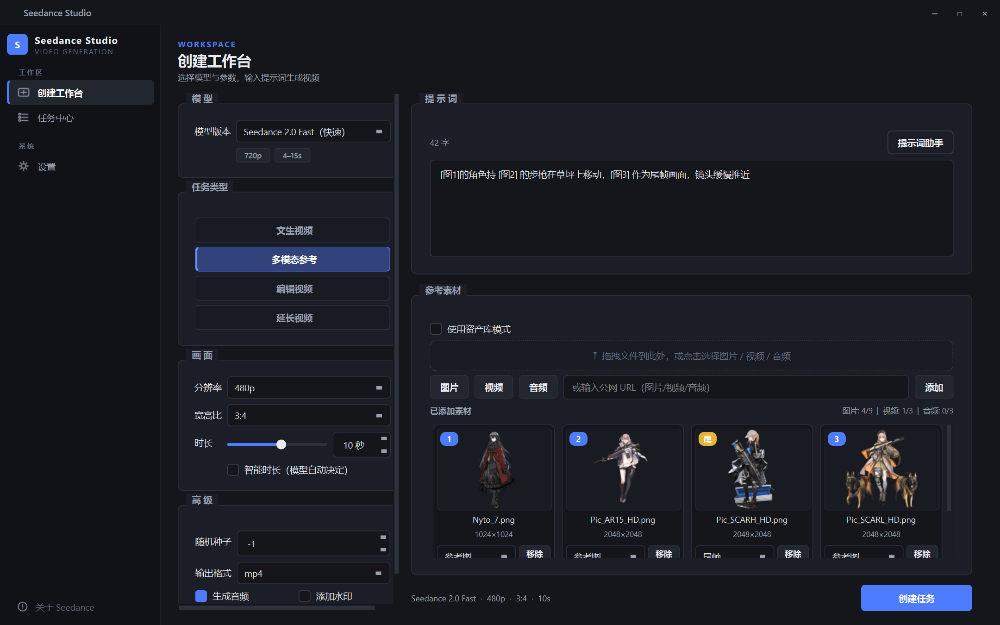
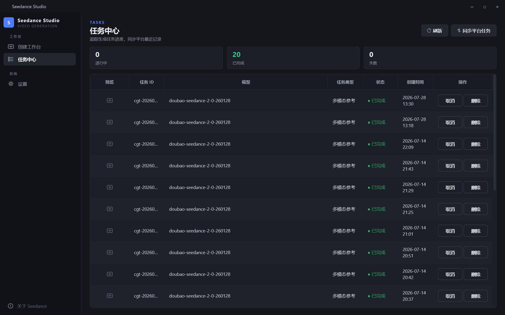

# Seedance Studio

> 象牙塔级的 AI 视频生成工作台 —— 基于字节跳动火山引擎 Doubao Seedance 模型，在 Windows 桌面上一键完成视频生成、编辑与延长，无需编写任何代码。



## 下载安装

从 [**Releases**](https://github.com/GerdonMa/SeedanceStudio/releases) 下载最新版 `SeedanceStudio-v1.3.0.exe`（单文件，约 62 MB），双击即可运行。

- **系统要求**：Windows 10 / 11（64 位），无需安装 Python 或其他依赖
- **账号准备**：一个[火山引擎](https://console.volcengine.com/ark)账号，开通 Doubao Seedance 模型并创建 [API Key](https://console.volcengine.com/ark/region:ark+cn-beijing/apiKey)

> 视频生成按 Token 用量计费，请确保账户余额充足（Seedance 2.x 要求余额 ≥ 200 元或已购资源包）。

## 三步生成你的第一个视频

1. **配置 Key**：打开软件 → 设置 → 粘贴 API Key → 点击「测试连接」（Key 使用 Fernet 加密存储在本机，不会明文落盘）
2. **描述画面**：在创建工作台选择模型与任务类型，在提示词区描述你想要的画面（可打开「提示词助手」套用模板和官方提示词公式）
3. **创建任务**：点击「创建任务」，到任务中心查看进度；完成后自动弹出预览窗，可在线播放并一键下载

## 功能特性

**生成能力（完整覆盖 Seedance 2.5 / 2.0 全系模型）**

| 特性 | 说明 |
|------|------|
| 4 个模型可选 | Seedance 2.5（最长 30 秒）、2.0（支持 4K）、2.0 Fast、2.0 Mini |
| 四种任务类型 | 文生视频 / 多模态参考 / 编辑视频 / 延长视频 |
| 参数随模型联动 | 分辨率、宽高比、时长范围、素材上限按所选模型自动适配，不会提交无效参数 |
| 智能时长 | 不确定时长时交给模型自动决定（官方 `duration=-1`） |
| 首帧 / 尾帧 | 参考图可指定首帧、尾帧角色，实现首尾帧定档生成 |
| 编号徽章 | 参考图自动编号，与提示词中 `[图1]`、`[图2]` 引用一一对应，点击可看原图 |
| 更多参数 | 随机种子（结果复现）、MOV 输出、返回尾帧图（连续生成分段视频）、生成音频、水印、联网搜索 |

**任务管理**

- 任务中心实时统计（进行中 / 已完成 / 失败），侧边栏显示运行中任务计数
- 表格内置**视频首帧预览缩略图**，双击即可播放
- 「同步平台任务」一键找回方舟平台最近 7 天的任务记录（换机、重装不丢历史）
- 视频预览窗：自动播放、进度拖动、音量控制，下载文件名自动带任务 ID

**素材与资产**

- 拖拽 / 文件选择 / 公网 URL 三种方式添加图片、视频、音频
- 流式网格浏览，多素材一目了然，数量上限随模型能力自动放宽（2.5 支持 30 图 + 10 视频 + 10 音频）
- 资产库模式：直接引用火山引擎已审核的授权素材（`asset://`）

**界面**

- 两套内置主题：**Graphite 工作台**（深灰蓝专业控制台）与**瑞士风格**（纸灰极简），随时切换
- 深浅状态徽章、流式素材网格、任务统计卡片、Toast 通知、无边框窗口



## 常见问题

**生成的视频打不开 / 预览报错？**
视频 URL 有效期仅 **24 小时**（下载次数上限 100 次），请在任务完成后及时下载到本地。

**任务一直排队？**
Seedance 个人认证账号限流为 180 次/分钟、3 个并发任务；高峰期排队属正常现象。任务记录平台保留 7 天。

**换电脑后 API Key 还能用吗？**
Key 加密密钥派生自机器信息，换机后需重新粘贴一次 Key。

## 快捷键

| 快捷键 | 功能 |
|--------|------|
| `Ctrl+1/2/3` | 切换 创建工作台 / 任务中心 / 设置 |
| `Escape` | 关闭通知 / 弹窗 |

---

## 从源码构建（开发者）

```bash
git clone https://github.com/GerdonMa/SeedanceStudio.git
cd SeedanceStudio
pip install -r requirements.txt
python main.py            # 运行
python -m PyInstaller --clean seedance.spec   # 打包 exe
```

架构设计、编码规范与任务清单等开发文档见仓库根目录的 `plan.md`、`coding_rules.md`、`testing_rules.md`、`todo.md`。

## 许可证

MIT License
